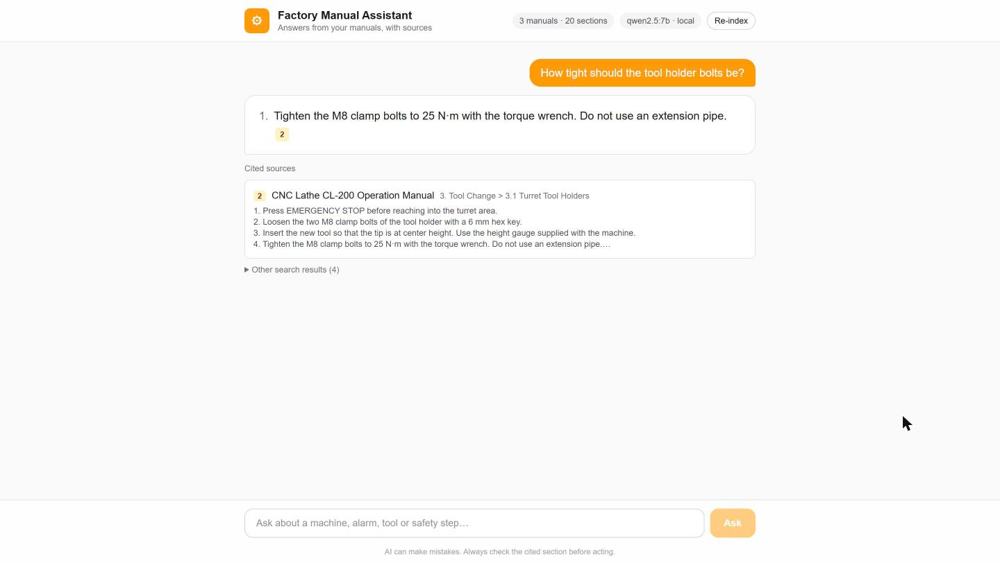
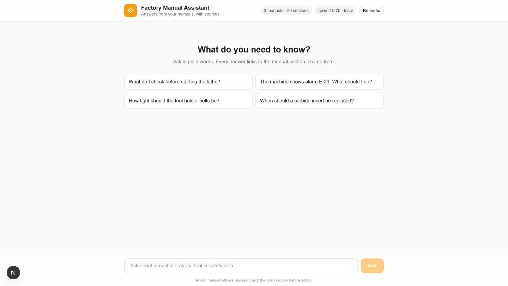
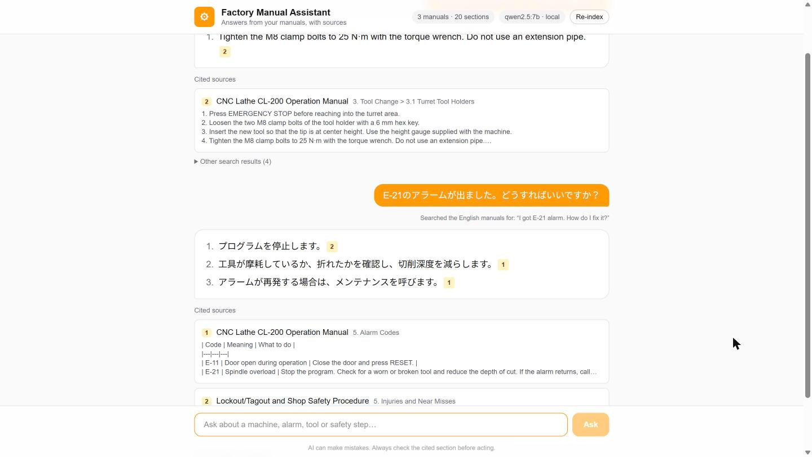
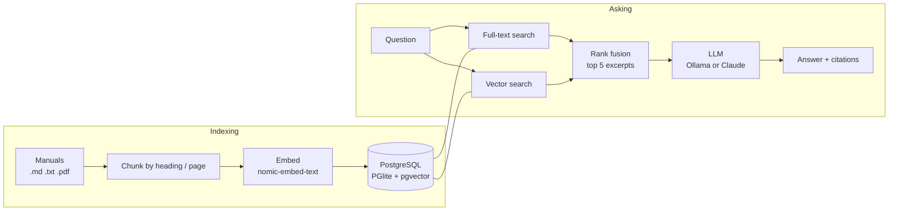

# Factory Manual Assistant

Ask a factory manual a question in plain words and get a short answer **with the exact manual section it came from**.

> "The machine shows alarm E-21. What should I do?"
> → *Stop the program and check for a worn or broken tool, then reduce the depth of cut. If the alarm returns, call maintenance.* **[1]**
> [1] CNC Lathe CL-200 Operation Manual · 5. Alarm Codes

Knowledge on a factory floor lives in thick manuals and in experienced workers' heads. New workers often don't know where to look, and a wrong guess about a torque value or a safety step can hurt someone. This project is a retrieval-augmented generation (RAG) assistant that only answers from the manuals it is given, cites every fact, and says "I couldn't find it, ask your supervisor" instead of guessing.



It runs **completely free and locally** with an open-source model through [Ollama](https://ollama.com). A setting switches it to Claude.

## Features

- **Answers with citations:** every fact links to a numbered source card showing the manual and section.
- **Hybrid search:** PostgreSQL full-text search finds exact terms such as `E-21` or `M8`, and pgvector semantic search finds meaning, so "the machine won't start" can match "spindle interlock". The two result lists are merged with Reciprocal Rank Fusion.
- **Grounded and safety-aware prompt:** the model must copy numbers exactly, put safety steps first, and refuse to guess.
- **Graceful degradation:** if the embedding model is unavailable, keyword search keeps working.
- **Bring your own manuals:** drop `.md`, `.txt` or `.pdf` files into `manuals/` and press **Re-index**.
- **Multilingual questions:** a Japanese or Russian question is translated into English for searching, and the answer comes back in the original language.
- **Local or cloud model:** free local model (default) or Claude via the Anthropic API, chosen with one environment variable.

## Screenshots

| Start screen | Japanese question, English manuals |
|---|---|
|  |  |

## How it works



1. **Chunking** (`src/lib/chunk.ts`): manuals are split by heading, or by page for PDFs, so each piece has a section name to cite. Long sections are split on paragraph boundaries.
2. **Storage** (`src/lib/db.ts`): [PGlite](https://pglite.dev) is real PostgreSQL compiled to WebAssembly, so there is no database server to install. A generated `tsvector` column powers keyword search, and a `vector` column stores embeddings.
3. **Retrieval** (`src/lib/search.ts`, `src/lib/rank.ts`): keyword and vector results are fused with Reciprocal Rank Fusion.
4. **Generation** (`src/lib/prompt.ts`, `src/app/api/ask/route.ts`): the top excerpts are numbered and sent to the model, and the answer streams back to the browser as newline-delimited JSON.

## Tech stack

TypeScript · Next.js (App Router) · React · Tailwind CSS · PostgreSQL (PGlite) · pgvector · Ollama · Anthropic SDK · Vitest

## Getting started

### 1. Install Ollama and the models (free)

Install Ollama from [ollama.com/download](https://ollama.com/download), then:

```bash
ollama pull qwen2.5:7b          # chat model, about 4.7 GB (runs well on an 8 GB GPU)
ollama pull nomic-embed-text    # embedding model, about 270 MB
```

### 2. Run the app

```bash
npm install
npm run dev
```

Open http://localhost:3000 and ask a question. The manuals are indexed automatically on the first question.

### Optional: use Claude instead

Copy `.env.example` to `.env.local` and set:

```bash
LLM_PROVIDER=anthropic
ANTHROPIC_API_KEY=your-key   # never commit this file
```

Embeddings still come from Ollama. Without Ollama, search falls back to keywords only.

## Using your own manuals

Put files into `manuals/` and click **Re-index** in the app (or stop the server and run `npm run ingest`). Supported formats are Markdown (sections come from headings), plain text, and PDF (sections are pages).

The three manuals in this repo (CNC lathe "CL-200", lockout/tagout, cutting tool care) are **fictional samples written for this demo**. They contain no real company's information.

## Tests

```bash
npm test          # Vitest: chunking, rank fusion, prompt building
npm run typecheck
```

## Project structure

```
manuals/              sample manuals (fictional)
scripts/ingest.ts     CLI indexer
src/app/page.tsx      chat UI with citation chips and source cards
src/app/api/ask       retrieval + streaming answer
src/app/api/index     index status and re-index
src/lib/              chunking, database, search, prompts, model clients
tests/                unit tests
```

## Limitations and next steps

- Each question is answered on its own, with no follow-up memory yet.
- The small local model (7B) sometimes picks a slightly wrong citation number or awkward wording in Japanese. Claude gives cleaner answers.
- PDF tables and scanned (image-only) PDFs are not parsed well. OCR would help.
- Next steps: an evaluation set of question/answer pairs to measure retrieval accuracy, re-ranking, a Japanese tokenizer for keyword search, and showing the source page side by side.

## Author

Shynggyskhan Duisen, Software Engineering student at Kyoto University of Advanced Science.
[LinkedIn](https://www.linkedin.com/in/shynggyskhan-duisen)

Built with the help of an AI coding assistant (Claude Code).

## License

MIT
